# TiDEomics Tutorial: Multi-Dataset/Multi-Omics Analysis

``` r

library(TiDEomics)
#> 
#> Registered S3 method overwritten by 'lme4':
#>   method           from
#>   na.action.merMod car
library(org.Mm.eg.db)
#> Loading required package: AnnotationDbi
#> Loading required package: stats4
#> Loading required package: BiocGenerics
#> Loading required package: generics
#> 
#> Attaching package: 'generics'
#> The following objects are masked from 'package:base':
#> 
#>     as.difftime, as.factor, as.ordered, intersect, is.element, setdiff,
#>     setequal, union
#> 
#> Attaching package: 'BiocGenerics'
#> The following objects are masked from 'package:stats':
#> 
#>     IQR, mad, sd, var, xtabs
#> The following object is masked from 'package:utils':
#> 
#>     data
#> The following objects are masked from 'package:base':
#> 
#>     anyDuplicated, aperm, append, as.data.frame, basename, cbind,
#>     colnames, dirname, do.call, duplicated, eval, evalq, Filter, Find,
#>     get, grep, grepl, is.unsorted, lapply, Map, mapply, match, mget,
#>     order, paste, pmax, pmax.int, pmin, pmin.int, Position, rank,
#>     rbind, Reduce, rownames, sapply, saveRDS, scale, sequence, table,
#>     tapply, transform, unique, unsplit, which.max, which.min
#> Loading required package: Biobase
#> Welcome to Bioconductor
#> 
#>     Vignettes contain introductory material; view with
#>     'browseVignettes()'. To cite Bioconductor, see
#>     'citation("Biobase")', and for packages 'citation("pkgname")'.
#> Loading required package: IRanges
#> Loading required package: S4Vectors
#> 
#> Attaching package: 'S4Vectors'
#> The following object is masked from 'package:utils':
#> 
#>     findMatches
#> The following objects are masked from 'package:base':
#> 
#>     expand.grid, I, unname
#> 
#> Attaching package: 'IRanges'
#> The following object is masked from 'package:grDevices':
#> 
#>     windows
#> 
```

## Introduction

This tutorial demonstrates the **multi-dataset/multi-omics** workflow of
[**TiDEomics**](https://bioconductor.org/packages/TiDEomics). It
complements the single-dataset workflow in the `TiDEomics Tutorial`
vignette (`browseVignettes("TiDEomics")`).

Key features covered:

- *Preparation of multiple datasets*: prepare, filter and combine
  datasets, retaining shared and dataset-specific features.

- *Multi-dataset exploratory visualisation*: plot temporal profiles,
  PCA, UMAP, and sample correlation matrices across datasets or omics
  layers.

- *Consensus co-expression module analysis*: identify and interpret
  consensus WGCNA modules across datasets, including integrated
  visualisation with functional enrichment.

- *Feature level comparison*: compare feature properties or feature set
  overlaps within or across datasets, with optional functional
  annotation.

In TiDEomics, a dataset is one `SummarizedExperiment` object. Multiple
datasets or omics layers are provided as a named list, e.g.
`list(Exp1 = se1, Exp2 = se2)`.

## Example input

The tutorial dataset was derived from GSE263759 (Traxler et al. 2025) as
described in the `TiDEomics Tutorial` vignette. `tutorial_data` and
`tutorial_sample_info` provide the sample expression and annotations:

``` r

data(tutorial_data, package = "TiDEomics")
data(tutorial_sample_info, package = "TiDEomics")

tutorial_data[1:5, 1:5]
```

```
#>    Feature RNA_untreated_0h_R1_1 RNA_untreated_24h_R1_2 RNA_IFNbeta_2h_R1_1
#> 1   Scpep1             14.348367              14.077291           14.182225
#> 2      Dbt              9.808077               9.868152            9.253170
#> 3   Tmigd3              0.000000               0.000000            8.669389
#> 4    Clcn4             11.690389              11.988953           11.296892
#> 5 Serpinf1              0.000000               5.805180            4.054922
#>   RNA_IFNbeta_24h_R1_2
#> 1            14.973840
#> 2             9.078798
#> 3             5.603607
#> 4            11.179112
#> 5             0.000000
```

Exp1 uses `tutorial_data` directly. Exp2 is generated from the same
table by adding noise and suffixing its first 50 feature names with
`_Exp2`, to simulate differences between datasets or omics layers.

``` r

tutorial_data_2 <- tutorial_data
exp1_values <- as.matrix(tutorial_data[, -1])
gene_sd <- apply(exp1_values, 1, sd)

set.seed(5678)
noise <- matrix(
    rnorm(length(exp1_values)),
    nrow = nrow(exp1_values)
)
tutorial_data_2[, -1] <- exp1_values + noise * 0.5 * gene_sd
tutorial_data_2$Feature[seq_len(50)] <- paste0(
    tutorial_data_2$Feature[seq_len(50)], "_Exp2"
)
```

The two datasets each have 50 dataset-specific features, while all other
features are shared:

``` r

shared_features <- intersect(tutorial_data$Feature, tutorial_data_2$Feature)
length(shared_features)
```

```
#> [1] 450
```

## Workflow

### Multi-dataset preparation

[`combine_tide()`](https://hte123.github.io/TiDEomics/reference/combine_tide.md)
accepts a list of
[`prepare_tide()`](https://hte123.github.io/TiDEomics/reference/prepare_tide.md)
outputs and returns the filtered objects including all features or
shared features only.

``` r

tide_results <- list()
tide_results[["Exp1"]] <- prepare_tide(
    data = tutorial_data, sample_ann = tutorial_sample_info,
    feature_threshold = 0, keep = "threshold", residual_threshold = 100)
#> No Subject column specified. Samples treated as independent. For repeated-measures designs, set subject_col to the column identifying biological subjects.
#> Converting 'Group' column to factor. Default order is alphabetical.
#> Converting 'Replicate' column to factor. Default order is numerical.
#> Converting 'Batch' column to factor. Default order is numerical.
#> Normalising to group baseline at each feature's first non-NA time point.
#> Preparing TiDEomics input: 500 features, 40 samples, 4 groups
#> Filtering criteria: >=50% values >0 in >=2 of groups: IFNbeta, IFNgamma, LPS, untreated
#> Cross-group filter (Exp_ratio >= 0.5 in >= 2 groups): kept 340 of 500 features (68%)
#> --- assay: orig ---
#> LMM: exp ~ (1|Group) + (1|Time)  |  Output: Group, Time, Residual
#> 340 features evaluated: 267 successful; 0 errors; 73 warnings; 0 skipped before fitting for insufficient observations or variance.
#> Residual filter (threshold): kept 334 of 340 features (98.2%)
#> --- assay: norm ---
#> LMM: exp ~ (1|Group) + (1|Time)  |  Output: Group, Time, Residual
#> 340 features evaluated: 267 successful; 0 errors; 73 warnings; 0 skipped before fitting for insufficient observations or variance.
#> Residual filter (threshold): kept 333 of 340 features (97.9%)
tide_results[["Exp2"]] <- prepare_tide(
    data = tutorial_data_2, sample_ann = tutorial_sample_info,
    feature_threshold = 0, keep = "threshold", residual_threshold = 100)
#> No Subject column specified. Samples treated as independent. For repeated-measures designs, set subject_col to the column identifying biological subjects.
#> Converting 'Group' column to factor. Default order is alphabetical.
#> Converting 'Replicate' column to factor. Default order is numerical.
#> Converting 'Batch' column to factor. Default order is numerical.
#> Normalising to group baseline at each feature's first non-NA time point.
#> Preparing TiDEomics input: 500 features, 40 samples, 4 groups
#> Filtering criteria: >=50% values >0 in >=2 of groups: IFNbeta, IFNgamma, LPS, untreated
#> Cross-group filter (Exp_ratio >= 0.5 in >= 2 groups): kept 459 of 500 features (91.8%)
#> --- assay: orig ---
#> LMM: exp ~ (1|Group) + (1|Time)  |  Output: Group, Time, Residual
#> 459 features evaluated: 289 successful; 0 errors; 170 warnings; 0 skipped before fitting for insufficient observations or variance.
#> Residual filter (threshold): kept 426 of 459 features (92.8%)
#> --- assay: norm ---
#> LMM: exp ~ (1|Group) + (1|Time)  |  Output: Group, Time, Residual
#> 459 features evaluated: 306 successful; 0 errors; 153 warnings; 0 skipped before fitting for insufficient observations or variance.
#> Residual filter (threshold): kept 437 of 459 features (95.2%)

combined <- combine_tide(tide_results, assay = 2)
#> Combining 2 prepare_tide() results using assay 'norm'
#> Shared filtered features: 289 (Exp1=333, Exp2=437)
names(combined)
```

```
#> [1] "se_list_filtered"        "se_list_merged"         
#> [3] "se_list_filtered_shared" "se_list_merged_shared"  
#> [5] "variance_decomp"         "shared_features"        
#> [7] "assay"                   "filter_summary"
combined$filter_summary
```

```
#>   Dataset n_total n_kept pct_kept residual_cutoff
#> 1    Exp1     500    333     66.6             100
#> 2    Exp2     500    437     87.4             100
```

The returned `filter_summary` reports the number and percentage of
features retained in each dataset. The `se_list_filtered` and
`se_list_merged` objects include dataset specific features, while
`se_list_filtered_shared` and `se_list_merged_shared` contain only
features retained by every dataset.

### Multi-dataset visualisation

[`plot_trend()`](https://hte123.github.io/TiDEomics/reference/plot_trend.md)
plots the mean and standard deviation of selected features over time.
The `multi_layout` argument controls the arrangement of datasets and
features, while `independent_y` controls whether panels use independent
or shared y-axis ranges:

``` r

plot_trend(combined$se_list_filtered,
    features = combined$shared_features[1:4], assay = 2,
    multi_layout = "wrap", independent_y = FALSE, ncol = 2
)
#> Group not specified. Plotting all groups: IFNbeta, IFNgamma, LPS, untreated
```

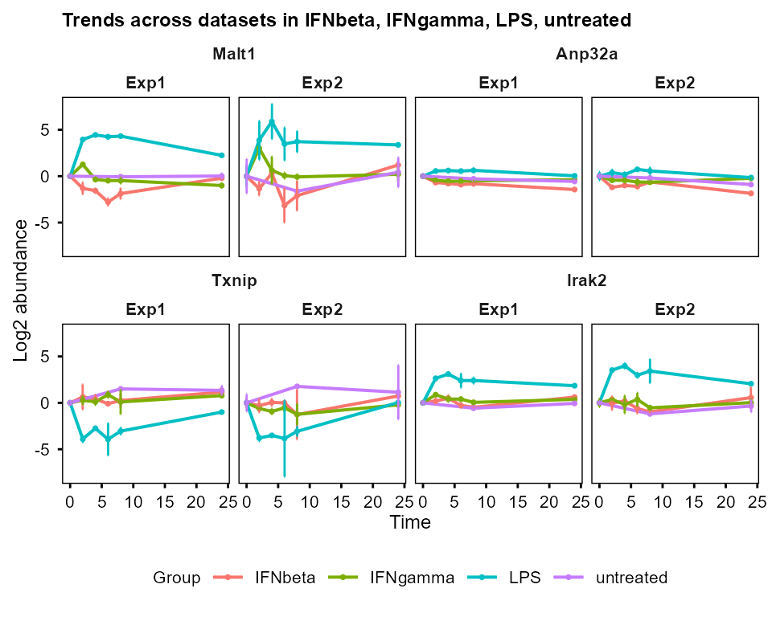

``` r


plot_trend(combined$se_list_filtered,
    features = combined$shared_features[1:4], assay = 2,
    multi_layout = "overlay", independent_y = TRUE, ncol = 2
)
#> Group not specified. Plotting all groups: IFNbeta, IFNgamma, LPS, untreated
```

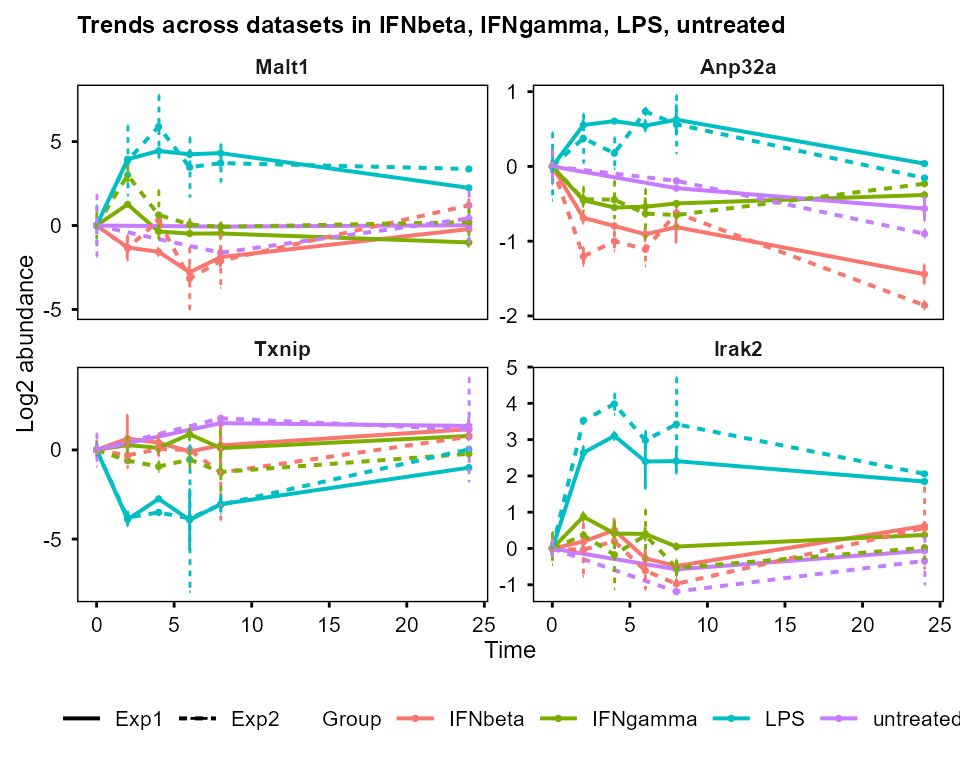

``` r


plot_trend(combined$se_list_filtered,
    features = combined$shared_features[1:4], assay = 2,
    multi_layout = "vertical", independent_y = FALSE
)
#> Group not specified. Plotting all groups: IFNbeta, IFNgamma, LPS, untreated
```

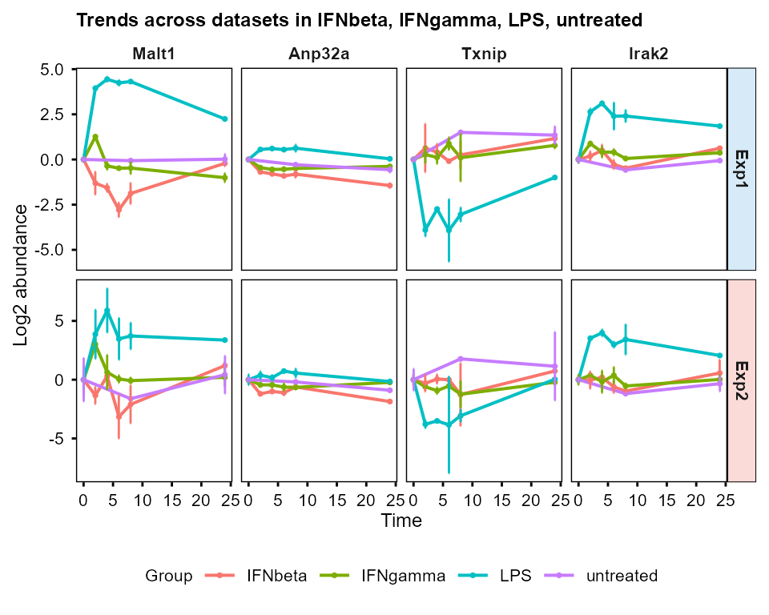

``` r


plot_trend(combined$se_list_filtered,
    features = combined$shared_features[1:4], assay = 2,
    multi_layout = "horizontal", independent_y = TRUE
)
#> Group not specified. Plotting all groups: IFNbeta, IFNgamma, LPS, untreated
```

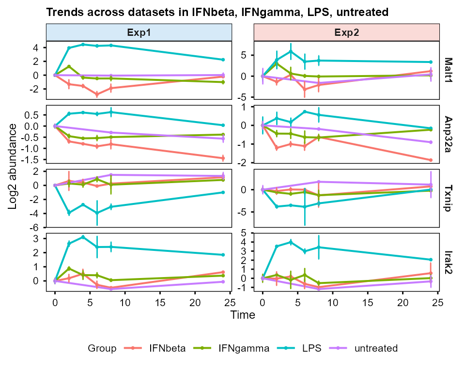

[`plot_pca()`](https://hte123.github.io/TiDEomics/reference/plot_pca.md),
[`plot_umap()`](https://hte123.github.io/TiDEomics/reference/plot_umap.md),
and
[`plot_cor_matrix()`](https://hte123.github.io/TiDEomics/reference/plot_cor_matrix.md)
accept the dataset list and plot the datasets side by side. With
`shared_only = TRUE`, PCA, UMAP, and correlation matrices are computed
on the features shared by all datasets, otherwise all eligible features
are used.

``` r

PC <- plot_pca(combined$se_list_filtered,
    assay = 2,
    shared_only = TRUE,
    plot_screeplot = TRUE,
    plot_loadings = FALSE,
    plot_morepc = FALSE
)
#> Subsetting features: Exp1=289, Exp2=289
#> Warning: Using `size` aesthetic for lines was deprecated in ggplot2 3.4.0.
#> ℹ Please use `linewidth` instead.
#> ℹ The deprecated feature was likely used in the PCAtools package.
#>   Please report the issue to the authors.
#> This warning is displayed once per session.
#> Call `lifecycle::last_lifecycle_warnings()` to see where this warning was
#> generated.
#> Warning: Using size for a discrete variable is not advised.
#> Using size for a discrete variable is not advised.
PC$plot
```

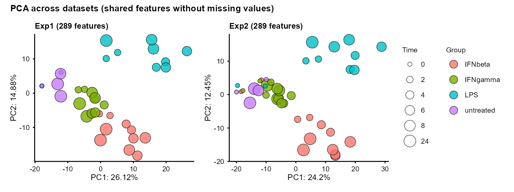

``` r

umap_out <- plot_umap(combined$se_list_filtered,
    seed = 1234, assay = 2,
    shared_only = FALSE
)
#> Exp1: using n_neighbors = 8
#> Warning: Using size for a discrete variable is not advised.
#> Exp2: using n_neighbors = 8
#> Warning: Using size for a discrete variable is not advised.
umap_out$plot
```

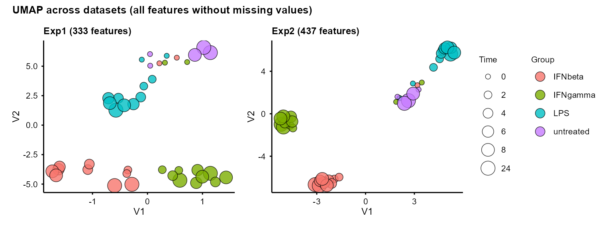

``` r

plot_cor_matrix(combined$se_list_filtered,
    method = "spearman",
    assay = 2,
    shared_only = FALSE,
    label_rep = TRUE, label_batch = TRUE,
    cellwidth = 1.5, cellheight = 1.5
)
#> Cophenetic correlation between datasets (Pearson): 0.96
```

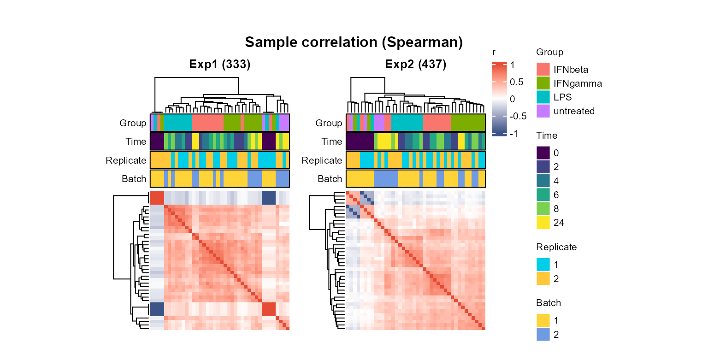

When datasets contain the same samples,
[`plot_cor_matrix()`](https://hte123.github.io/TiDEomics/reference/plot_cor_matrix.md)
reports clustering similarity using correlation of cophenetic distances.

The other TiDEomics functions can be applied separately to each dataset
(e.g. `combined$se_list_filtered$Exp1` and
`combined$se_list_filtered$Exp2`), as described in the main tutorial.

### Consensus WGCNA

Consensus WGCNA identifies co-expression modules that are present across
all or most datasets (Zhang and Horvath 2005; Langfelder and Horvath
2008, 2012). Only features shared by all datasets are included, so the
`se_list_filtered_shared` from
[`combine_tide()`](https://hte123.github.io/TiDEomics/reference/combine_tide.md)
output is used.

First, scale-free topology fit is assessed and the suitable power is
picked for each dataset with
[`prepare_WGCNA()`](https://hte123.github.io/TiDEomics/reference/prepare_WGCNA.md):

``` r

inp1 <- prepare_WGCNA(combined$se_list_filtered_shared$Exp1,
    assay = 2, powers = seq(1, 20),
    networkType = "signed", RsquaredCut = 0.8
)
```

```
#> Allowing multi-threading with up to 24 threads.
#> pickSoftThreshold: will use block size 289.
#>  pickSoftThreshold: calculating connectivity for given powers...
#>    ..working on genes 1 through 289 of 289
#>    Power SFT.R.sq  slope truncated.R.sq mean.k. median.k. max.k.
#> 1      1   0.7930  3.770         0.7570  157.00   162.000 185.00
#> 2      2   0.0471  0.298         0.0103   94.20    96.900 133.00
#> 3      3   0.3230 -0.857         0.3510   60.50    61.400 101.00
#> 4      4   0.5250 -0.991         0.6590   40.90    40.300  79.10
#> 5      5   0.5780 -1.060         0.7930   28.70    27.400  63.30
#> 6      6   0.6320 -1.110         0.8610   20.80    18.700  51.60
#> 7      7   0.7020 -1.140         0.9010   15.50    13.100  42.70
#> 8      8   0.7670 -1.140         0.9530   11.70     9.670  35.70
#> 9      9   0.7970 -1.160         0.9650    9.09     7.150  30.10
#> 10    10   0.8070 -1.170         0.9760    7.14     5.330  25.70
#> 11    11   0.7980 -1.230         0.9690    5.70     4.100  22.00
#> 12    12   0.7640 -1.290         0.9320    4.60     3.300  19.10
#> 13    13   0.7800 -1.290         0.9330    3.75     2.640  16.60
#> 14    14   0.7940 -1.340         0.9440    3.09     2.120  14.50
#> 15    15   0.8010 -1.380         0.9200    2.57     1.740  12.80
#> 16    16   0.8520 -1.380         0.9700    2.15     1.430  11.30
#> 17    17   0.8570 -1.350         0.9720    1.81     1.210  10.00
#> 18    18   0.8560 -1.350         0.9520    1.54     0.998   8.95
#> 19    19   0.8580 -1.360         0.9490    1.31     0.832   8.02
#> 20    20   0.8790 -1.400         0.9520    1.13     0.676   7.21
#> WGCNA powerEstimate: 10 (unsigned SFT.R.sq > 0.8); custom_powerEstimate: 10 (signed R-squared > 0.8).
inp1$plot
```

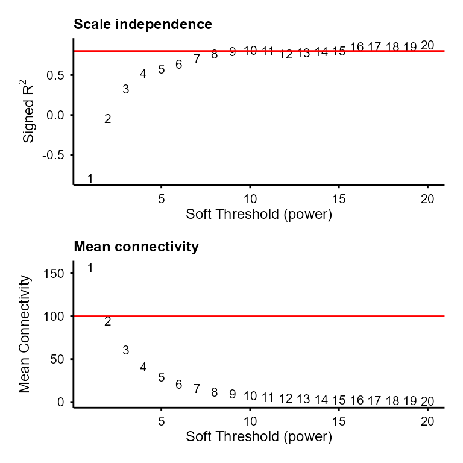

``` r


inp2 <- prepare_WGCNA(combined$se_list_filtered_shared$Exp2,
    assay = 2, powers = seq(1, 20),
    networkType = "signed", RsquaredCut = 0.8
)
```

```
#> Allowing multi-threading with up to 24 threads.
#> pickSoftThreshold: will use block size 289.
#>  pickSoftThreshold: calculating connectivity for given powers...
#>    ..working on genes 1 through 289 of 289
#>    Power SFT.R.sq  slope truncated.R.sq mean.k. median.k. max.k.
#> 1      1    0.778  4.300          0.755 154.000   158.000 178.00
#> 2      2    0.111  0.549          0.296  89.000    90.900 120.00
#> 3      3    0.254 -0.737          0.434  54.300    54.400  84.50
#> 4      4    0.586 -1.130          0.701  34.600    34.000  61.70
#> 5      5    0.653 -1.230          0.777  22.900    21.900  46.30
#> 6      6    0.729 -1.300          0.883  15.600    14.400  35.50
#> 7      7    0.790 -1.320          0.934  10.900     9.570  27.60
#> 8      8    0.779 -1.310          0.893   7.770     6.470  21.80
#> 9      9    0.805 -1.330          0.935   5.640     4.500  17.50
#> 10    10    0.827 -1.360          0.959   4.160     3.180  14.10
#> 11    11    0.837 -1.380          0.958   3.120     2.320  11.50
#> 12    12    0.811 -1.430          0.919   2.360     1.670   9.43
#> 13    13    0.836 -1.390          0.963   1.810     1.250   7.80
#> 14    14    0.815 -1.450          0.967   1.400     0.963   6.49
#> 15    15    0.825 -1.460          0.950   1.100     0.744   5.43
#> 16    16    0.852 -1.490          0.960   0.863     0.580   4.56
#> 17    17    0.853 -1.520          0.931   0.686     0.441   3.85
#> 18    18    0.873 -1.520          0.953   0.548     0.345   3.27
#> 19    19    0.882 -1.530          0.950   0.441     0.274   2.79
#> 20    20    0.878 -1.530          0.936   0.357     0.218   2.38
#> WGCNA powerEstimate: 9 (unsigned SFT.R.sq > 0.8); custom_powerEstimate: 9 (signed R-squared > 0.8).
inp2$plot
```

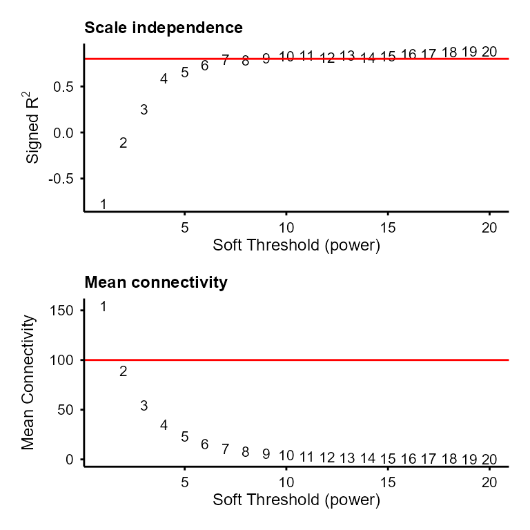

[`run_consensus_WGCNA()`](https://hte123.github.io/TiDEomics/reference/run_consensus_WGCNA.md)
then computes consensus network and modules across the datasets.

``` r

cons <- run_consensus_WGCNA(
    nets = list(Exp1 = inp1, Exp2 = inp2),
    powers = c(
        Exp1 = inp1$custom_powerEstimate,
        Exp2 = inp2$custom_powerEstimate
    ),
    minModuleSize = 10
)
#> Powers differ across datasets (Exp1=10, Exp2=9). Passing per-dataset powers.
#> Common features across 2 datasets: 289
#>   Exp1: 289 features
#>   Exp2: 289 features
#> Running blockwise consensus WGCNA...
```

```
#> Allowing multi-threading with up to 24 threads.
#>  Calculating consensus modules and module eigengenes block-wise from all genes
#>  Calculating topological overlaps block-wise from all genes
#>    Flagging genes and samples with too many missing values...
#>     ..step 1
#>  ....Working on set 1
#>     TOM calculation: adjacency..
#>     ..will not use multithreading.
#>      Fraction of slow calculations: 0.000000
#>     ..connectivity..
#>     ..matrix multiplication (system BLAS)..
#>     ..normalization..
#>     ..done.
#>  ....Working on set 2
#>     TOM calculation: adjacency..
#>     ..will not use multithreading.
#>      Fraction of slow calculations: 0.000000
#>     ..connectivity..
#>     ..matrix multiplication (system BLAS)..
#>     ..normalization..
#>     ..done.
#>  ..Working on block 1 .
#>  ....Working on set 1
#>  ....Working on set 2
#>  ....Calculating consensus network
#>  ..Working on block 1 .
#>  ....clustering and detecting modules..
#>  ....calculating eigengenes..
#>  ....checking consensus modules for statistical meaningfulness..
#>  ....checking for genes that should be reassigned..
#>  ..merging consensus modules that are too close..
#>      mergeCloseModules: Merging modules whose distance is less than 0.15
#>        Calculating new MEs...
#> Consensus WGCNA complete.
```

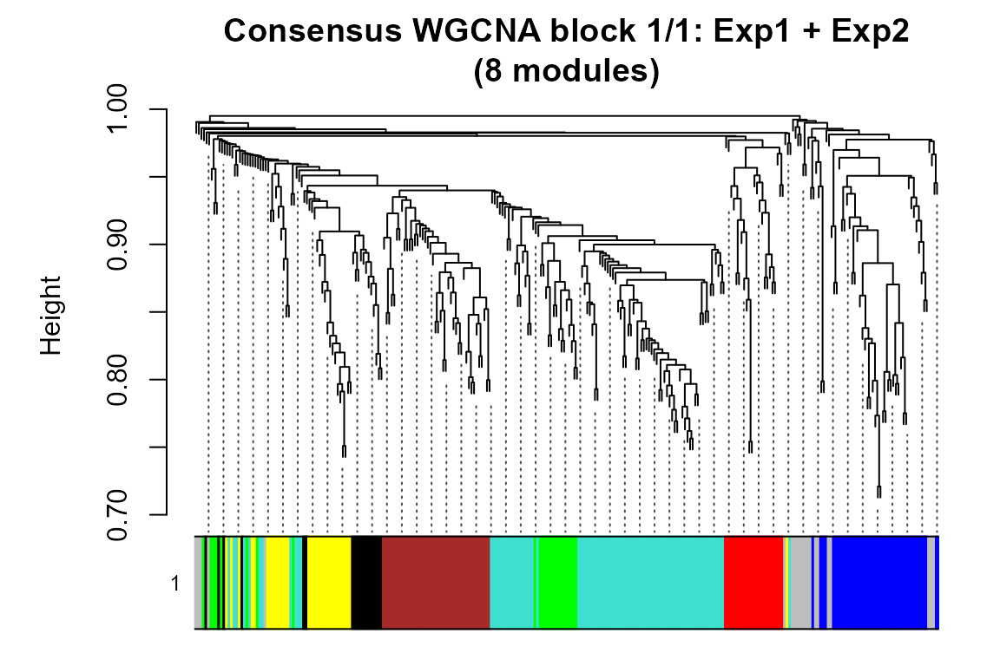

The features with the highest module membership (kME) per module can be
extracted with
[`extract_consensus_hubs()`](https://hte123.github.io/TiDEomics/reference/extract_consensus_hubs.md).
The result is a table containing consensus and dataset-specific hub
feature sets:

``` r

hubs <- extract_consensus_hubs(cons, top_n = 1)
head(hubs)
```

```
#>   Feature Module           Set Rank     Score     ScoreType
#> 1  Anp32a      6 Consensus hub    1 0.8003260 consensus.kME
#> 2   Memo1      5 Consensus hub    1 0.8321700 consensus.kME
#> 3   Prps2      4 Consensus hub    1 0.8706139 consensus.kME
#> 4  Epsti1      2 Consensus hub    1 0.8549250 consensus.kME
#> 5   Cebpz      3 Consensus hub    1 0.8782984 consensus.kME
#> 6     Gne      1 Consensus hub    1 0.8783234 consensus.kME
```

Module feature counts and module membership summaries can be reported
with
[`summarise_module_metrics()`](https://hte123.github.io/TiDEomics/reference/summarise_module_metrics.md):

``` r

module_metrics <- summarise_module_metrics(cons)
module_metrics$Consensus
```

```
#>   Module Size Proportion   MeanKME  MeanKME2 MedianKME     SDKME    Q25KME
#> 1     M1   87 0.30103806 0.5966612 0.3858515 0.6251776 0.1737642 0.4931523
#> 2     M2   42 0.14532872 0.5480876 0.3343622 0.5848404 0.1865222 0.4428649
#> 3     M3   42 0.14532872 0.6481362 0.4355433 0.6591775 0.1258566 0.5445825
#> 4     M4   32 0.11072664 0.5575302 0.3527937 0.5516405 0.2081038 0.3896362
#> 5     M5   24 0.08304498 0.6333115 0.4285321 0.6829616 0.1692396 0.4908153
#> 6     M6   23 0.07958478 0.5509666 0.3283228 0.5579894 0.1608849 0.4377496
#> 7     M7   18 0.06228374 0.6327071 0.4356516 0.7078196 0.1934214 0.5191811
#>      Q75KME    MinKME    MaxKME
#> 1 0.7254651 0.2169958 0.8783234
#> 2 0.7042205 0.2021847 0.8549250
#> 3 0.7552620 0.4166140 0.8782984
#> 4 0.7642333 0.2077125 0.8706139
#> 5 0.7911094 0.2808667 0.8321700
#> 6 0.6819894 0.2666639 0.8003260
#> 7 0.7543074 0.2351734 0.8502462
```

### Visualisation of co-expressed modules

The feature-module assignment can be extracted with
[`WGCNA_module()`](https://hte123.github.io/TiDEomics/reference/WGCNA_module.md)
and visualised by heatmap, using the replicate-merged expression data of
each dataset, as the `se_list_merged_shared` output from
[`combine_tide()`](https://hte123.github.io/TiDEomics/reference/combine_tide.md):

``` r

cons_module <- WGCNA_module(cons$network, exclude_grey = TRUE)
```

[`plot_modules_v()`](https://hte123.github.io/TiDEomics/reference/plot_modules_v.md)
stacks the per-dataset module profiles vertically:

``` r

plot_modules_v(cons_module, combined$se_list_merged_shared,
    assay = 2, scale = TRUE,
    height_ratio = 2)
#> Warning: Removed 804 rows containing non-finite outside the scale range
#> (`stat_summary()`).
#> Removed 804 rows containing non-finite outside the scale range
#> (`stat_summary()`).
```

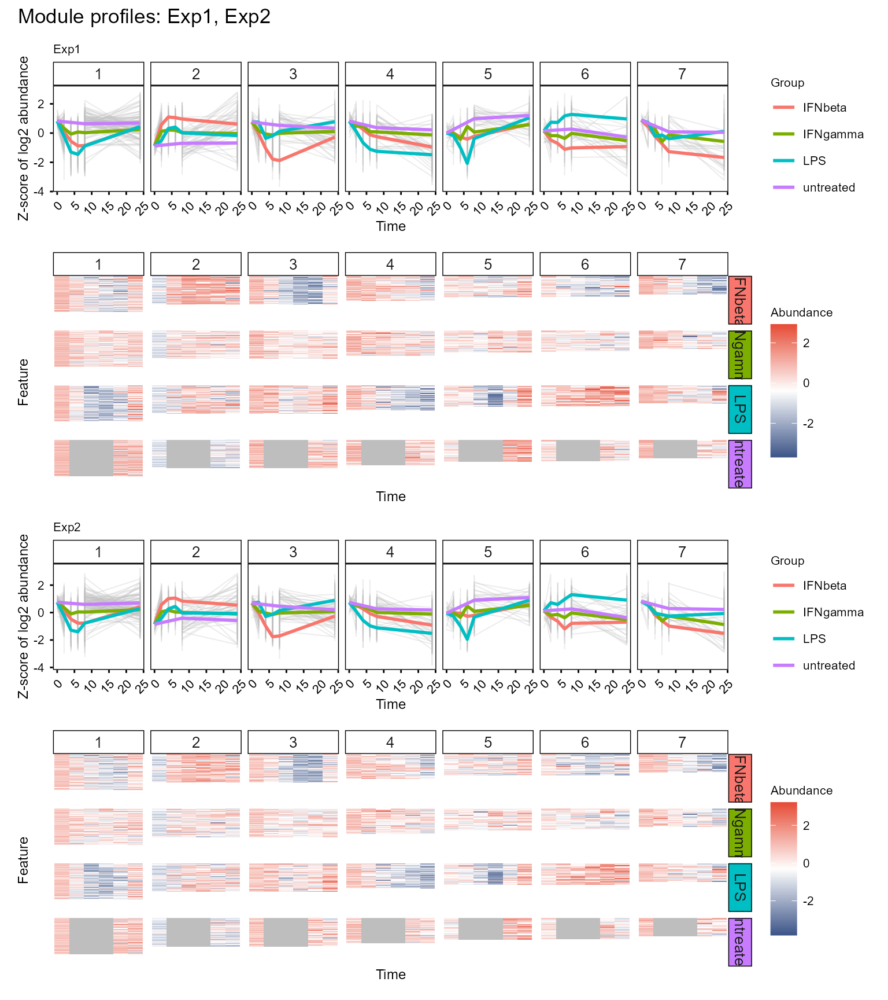

[`plot_modules_h()`](https://hte123.github.io/TiDEomics/reference/plot_modules_h.md)
provides the horizontal layout with optional enrichment annotations,
similar to the single dataset usage. Module profile y-axis scaling,
group annotations, marked features, and legend position can also be
customised.

In the below example, the hub features are coloured by categories, and
the module profiles use shared y-axis across all modules and datasets.

``` r

hub_colours <- c(
    "Consensus hub" = "#0072B2",
    "Exp1 hub" = "#D55E00",
    "Exp2 hub" = "#009E73"
)

plot_modules_h(cons_module, combined$se_list_merged_shared,
    assay = 2, scale = TRUE,
    mark_features = hubs,
    feature_colours = hub_colours,
    profile_scale = "shared", # or "dataset", "free"
    group_annotation = "both", # or "name", "colour", "none"
    legend_position = "right", # or "bottom"
    heatmap_width = 5, heatmap_height = 8,
    profile_width = 3
)
```

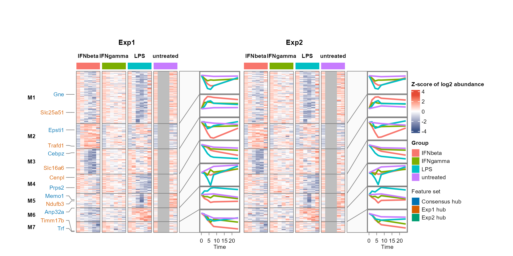

[`plot_modules_h()`](https://hte123.github.io/TiDEomics/reference/plot_modules_h.md)
also supports selection of specific modules to display with
`selected_modules` and wrapping long enrichment terms with
`enrich_wrap_width`:

``` r

module_background <- WGCNA_module(cons$network, exclude_grey = FALSE)$Feature

go_modules <- enrichGO_list(cons_module,
    OrgDb = org.Mm.eg.db,
    universe = module_background,
    category = "BP",
    pvalueCutoff = 1, qvalueCutoff = 1) # keep all terms for visualisation
#> Performing GO enrichment for category: BP
#> Processing gene list: 1
#> Processing gene list: 2
#> Processing gene list: 3
#> Processing gene list: 4
#> Processing gene list: 5
#> Processing gene list: 6
#> Processing gene list: 7
#> Merging GO enrichment results across gene lists for each category.

plot_modules_h(cons_module, combined$se_list_merged_shared,
    assay = 2, scale = TRUE,
    mark_features = hubs,
    feature_colours = hub_colours,
    enrich_list = go_modules$all,
    enrich_category = c("BP", "Features"),
    enrich_wrap_width = 4,
    profile_scale = "free", # or "dataset", "shared"
    group_annotation = "colour", # or "name", "both", "none"
    legend_position = "right",
    heatmap_width = 3, heatmap_height = 8,
    profile_width = 3,
    selected_modules = c(2, 5)
)
```

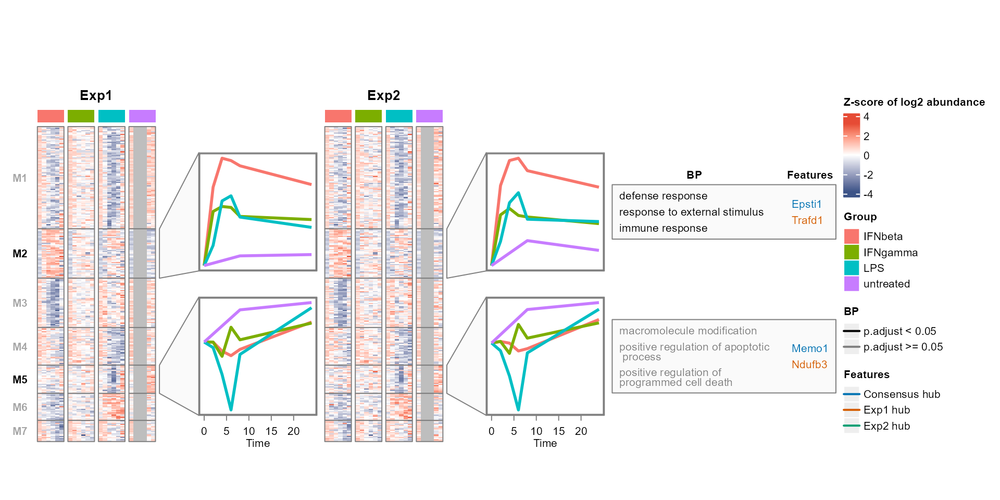

### Feature overlap or property comparison

Feature overlap or property comparisons can be across datasets or omics
layers, or within a single dataset. For example, one can compare
specific contrasts or properties of different modules from one dataset.

The feature overlap can be visualised with
[`plot_upset_h()`](https://hte123.github.io/TiDEomics/reference/plot_upset_h.md)
and
[`plot_upset_v()`](https://hte123.github.io/TiDEomics/reference/plot_upset_v.md),
based on
[`ComplexHeatmap::UpSet()`](https://rdrr.io/pkg/ComplexHeatmap/man/UpSet.html)
(Gu et al. 2016; Gu 2022).

For
[`plot_upset_h()`](https://hte123.github.io/TiDEomics/reference/plot_upset_h.md),
functional enrichment terms (Yu 2024; Xu et al. 2024; Wu et al. 2021; Yu
et al. 2012) for the feature set intersections can be added as a
horizontally aligned textbox:

``` r

set_list <- lapply(combined$se_list_filtered, rownames)
background_features <- unique(unlist(set_list))

feature_sets <- list(
    Exp1_Exp2 = intersect(set_list$Exp1, set_list$Exp2),
    Exp1 = setdiff(set_list$Exp1, set_list$Exp2),
    Exp2 = setdiff(set_list$Exp2, set_list$Exp1)
)

go_all <- enrichGO_list(feature_sets,
    OrgDb = org.Mm.eg.db,
    universe = background_features,
    category = "BP",
    pvalueCutoff = 1, qvalueCutoff = 1) # keep all terms for visualisation
#> Performing GO enrichment for category: BP
#> Processing gene list: Exp1_Exp2
#> Processing gene list: Exp1
#> Processing gene list: Exp2
#> Merging GO enrichment results across gene lists for each category.

plot_upset_h(set_list,
    enrich_list = go_all$all,
    enrich_category = "BP",
    enrich_top_n = 2,
    enrich_wrap_width = 7
)
#> Intersection pattern to label mapping:
#>   11: Exp1_Exp2
#>   10: Exp1
#>   01: Exp2
```

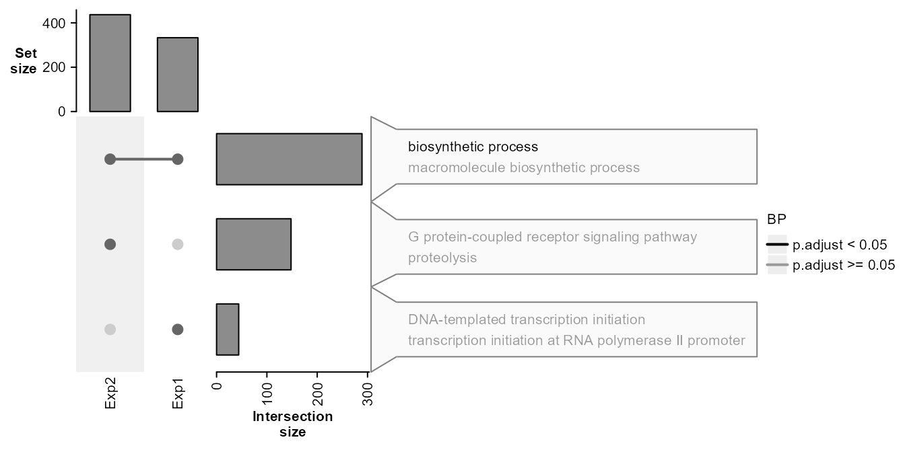

[`plot_upset_v()`](https://hte123.github.io/TiDEomics/reference/plot_upset_v.md)
allows a vertically aligned enrichment term dot matrix below the Upset
plot. The term ordering and colours can be customised with
`enrich_term_order` and `enrich_term_colours`, and `term_wrap_width`
controls term wrapping (similar to `enrich_wrap_width` for
[`plot_upset_h()`](https://hte123.github.io/TiDEomics/reference/plot_upset_h.md)).

``` r

bp_terms <- unique(as.data.frame(go_all$all$BP)$ID)
enrich_term_colours <- stats::setNames(
    rep(c("#0072B2", "#D55E00", "#009E73", "black"),
        length.out = length(bp_terms)),
    bp_terms
)

plot_upset_v(set_list,
    enrich_list = go_all$all,
    enrich_category = "BP",
    enrich_top_n = 2,
    term_wrap_width = 50,
    enrich_term_order = "intersection", # or "rank"
    enrich_term_colours = enrich_term_colours,
    include_all = FALSE # see clusterProfiler::dotplot `includeAll` usage
)
#> Intersection pattern to label mapping:
#>   11: Exp1_Exp2
#>   10: Exp1
#>   01: Exp2
```

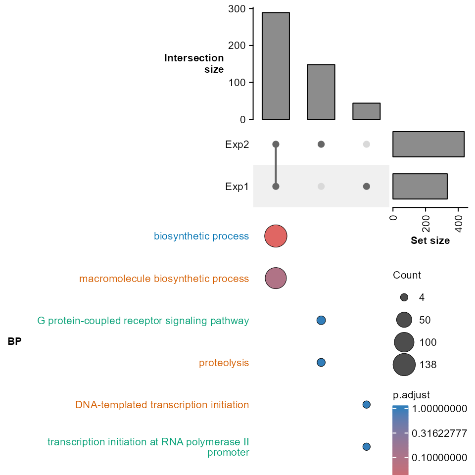

Per-feature properties can be compared with
[`plot_scatter()`](https://hte123.github.io/TiDEomics/reference/plot_scatter.md).
Here the feature mean abundance is compared between the two datasets:

``` r

exp1_stat <- data.frame(
    Feature = rownames(combined$se_list_filtered$Exp1),
    Mean = rowMeans(
        SummarizedExperiment::assay(combined$se_list_filtered$Exp1, 2),
        na.rm = TRUE
    )
)
exp2_stat <- data.frame(
    Feature = rownames(combined$se_list_filtered$Exp2),
    Mean = rowMeans(
        SummarizedExperiment::assay(combined$se_list_filtered$Exp2, 2),
        na.rm = TRUE
    )
)

plot_scatter(exp1_stat, exp2_stat,
    col1 = "Mean", col2 = "Mean",
    name1 = "Exp1 mean abundance",
    name2 = "Exp2 mean abundance",
    colour_threshold = c(x = 1, y = 1),
    label_threshold = c(x = 2.5, y = 2.5)
)
```

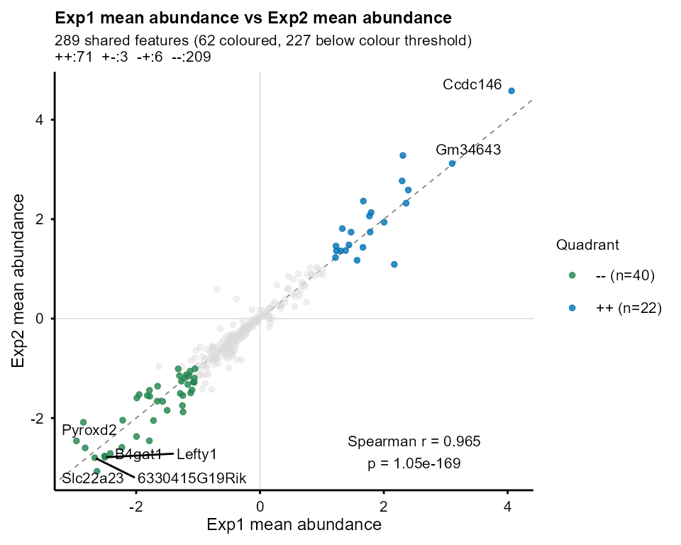

## Session information

``` r

sessionInfo()
```

```
#> R version 4.6.1 (2026-06-24 ucrt)
#> Platform: x86_64-w64-mingw32/x64
#> Running under: Windows 11 x64 (build 26200)
#> 
#> Matrix products: default
#>   LAPACK version 3.12.1
#> 
#> locale:
#> [1] LC_COLLATE=English_United Kingdom.utf8 
#> [2] LC_CTYPE=English_United Kingdom.utf8   
#> [3] LC_MONETARY=English_United Kingdom.utf8
#> [4] LC_NUMERIC=C                           
#> [5] LC_TIME=English_United Kingdom.utf8    
#> 
#> time zone: Europe/London
#> tzcode source: internal
#> 
#> attached base packages:
#> [1] stats4    stats     graphics  grDevices utils     datasets  methods  
#> [8] base     
#> 
#> other attached packages:
#> [1] org.Mm.eg.db_3.23.0  AnnotationDbi_1.75.2 IRanges_2.47.5      
#> [4] S4Vectors_0.51.10    Biobase_2.73.2       BiocGenerics_0.59.12
#> [7] generics_0.1.4       TiDEomics_0.99.7     BiocStyle_2.41.0    
#> 
#> loaded via a namespace (and not attached):
#>   [1] segmented_2.2-2             fs_2.1.0                   
#>   [3] matrixStats_1.5.0           bitops_1.1-0               
#>   [5] enrichplot_1.99.8           httr_1.4.9                 
#>   [7] RColorBrewer_1.1-3          doParallel_1.0.17          
#>   [9] ggsci_5.2.0                 dynamicTreeCut_1.63-1      
#>  [11] tools_4.6.1                 backports_1.5.1            
#>  [13] R6_2.6.1                    lazyeval_0.2.3             
#>  [15] GetoptLong_1.1.1            withr_3.0.3                
#>  [17] gridExtra_2.3.1             preprocessCore_1.75.1      
#>  [19] WGCNA_1.74                  cli_3.6.6                  
#>  [21] textshaping_1.0.5           scatterpie_0.2.6           
#>  [23] labeling_0.4.3              sass_0.4.10                
#>  [25] S7_0.2.2                    askpass_1.2.1              
#>  [27] pbapply_1.7-5               ggridges_0.5.7             
#>  [29] pkgdown_2.2.1               systemfonts_1.3.2          
#>  [31] yulab.utils_0.2.5           gson_0.2.2                 
#>  [33] foreign_0.8-92              DOSE_4.7.3                 
#>  [35] dichromat_2.0-1             limma_3.99.3               
#>  [37] rstudioapi_0.19.0           impute_1.87.0              
#>  [39] RSQLite_3.53.3              gridGraphics_0.5-1         
#>  [41] shape_1.4.6.1               gtools_3.9.5               
#>  [43] car_3.1-5                   dplyr_1.2.1                
#>  [45] GO.db_3.23.1                Matrix_1.7-6               
#>  [47] abind_1.4-8                 PCAtools_2.25.1            
#>  [49] lifecycle_1.0.5             yaml_2.3.12                
#>  [51] carData_3.0-6               SummarizedExperiment_1.43.0
#>  [53] gplots_3.3.0                qvalue_2.45.0              
#>  [55] SparseArray_1.13.4          grid_4.6.1                 
#>  [57] blob_1.3.0                  promises_1.5.0             
#>  [59] dqrng_0.4.1                 crayon_1.5.3               
#>  [61] ggtangle_0.1.4              lattice_0.23-1             
#>  [63] beachmat_2.29.3             cowplot_1.2.0              
#>  [65] KEGGREST_1.53.6             magick_2.9.1               
#>  [67] pillar_1.11.1               knitr_1.52                 
#>  [69] ComplexHeatmap_2.29.0       GenomicRanges_1.65.4       
#>  [71] rjson_0.2.23                boot_1.3-32                
#>  [73] codetools_0.2-20            glue_1.8.1                 
#>  [75] ggiraph_0.9.6               ggfun_0.2.2                
#>  [77] fontLiberation_0.1.0        data.table_1.18.6.1        
#>  [79] vctrs_0.7.3                 png_0.1-9                  
#>  [81] treeio_1.37.1               Rdpack_2.6.6               
#>  [83] gtable_0.3.6                cachem_1.1.0               
#>  [85] xfun_0.62                   rbibutils_2.4.1            
#>  [87] S4Arrays_1.13.2             mime_0.13                  
#>  [89] Seqinfo_1.3.2               reformulas_0.4.4           
#>  [91] survival_3.8-12             aisdk_1.4.12               
#>  [93] iterators_1.0.14            statmod_1.5.2              
#>  [95] nlme_3.1-171                ggtree_4.3.0               
#>  [97] bit64_4.8.6                 fontquiver_0.2.1           
#>  [99] bslib_0.12.0                irlba_2.4.1                
#> [101] KernSmooth_2.23-27          otel_0.2.0                 
#> [103] rpart_4.1.27                colorspace_2.1-4           
#> [105] DBI_1.3.0                   Hmisc_5.3-0                
#> [107] nnet_7.3-21                 tidyselect_1.2.1           
#> [109] processx_3.9.0              bit_4.6.0                  
#> [111] compiler_4.6.1              httr2_1.3.0                
#> [113] htmlTable_2.5.0             randtests_1.0.2            
#> [115] desc_1.4.3                  fontBitstreamVera_0.1.1    
#> [117] DelayedArray_0.39.8         bookdown_0.48              
#> [119] checkmate_2.3.4             scales_1.4.0               
#> [121] caTools_1.18.4              callr_3.8.0                
#> [123] rappdirs_0.3.4              stringr_1.6.0              
#> [125] digest_0.6.39               minqa_1.2.8                
#> [127] rmarkdown_2.32              XVector_0.53.0             
#> [129] htmltools_0.5.9             pkgconfig_2.0.3            
#> [131] base64enc_0.1-6             umap_0.2.10.0              
#> [133] lme4_2.1-0                  sparseMatrixStats_1.25.0   
#> [135] MatrixGenerics_1.25.0       fastmap_1.2.0              
#> [137] rlang_1.3.0                 GlobalOptions_0.1.4        
#> [139] htmlwidgets_1.6.4           shiny_1.14.0               
#> [141] DelayedMatrixStats_1.35.0   ggh4x_0.3.1                
#> [143] farver_2.1.2                jquerylib_0.1.4            
#> [145] jsonlite_2.0.0              BiocParallel_1.47.0        
#> [147] GOSemSim_2.39.4             BiocSingular_1.29.2        
#> [149] magrittr_2.0.5              Formula_1.2-6              
#> [151] ggplotify_0.1.4             patchwork_1.3.2            
#> [153] Rcpp_1.1.2                  reticulate_1.47.0          
#> [155] ape_5.8-1                   ggnewscale_0.5.2           
#> [157] gdtools_0.5.2               stringi_1.8.9              
#> [159] MASS_7.3-66                 plyr_1.8.9                 
#> [161] shinyFiles_0.9.3            parallel_4.6.1             
#> [163] ggrepel_0.9.8               Biostrings_2.81.9          
#> [165] splines_4.6.1               circlize_0.4.18            
#> [167] igraph_2.3.4                ggpubr_1.0.0               
#> [169] fastcluster_1.3.0           ggsignif_0.6.4             
#> [171] enrichit_0.2.7              reshape2_1.4.5             
#> [173] ScaledMatrix_1.21.0         evaluate_1.0.5             
#> [175] BiocManager_1.30.27         nloptr_2.2.1               
#> [177] foreach_1.5.2               tweenr_2.0.3               
#> [179] httpuv_1.6.17               openssl_2.4.2              
#> [181] tidyr_1.3.2                 purrr_1.2.2                
#> [183] polyclip_1.10-7             clue_0.3-68                
#> [185] ggplot2_4.0.3               Trendy_1.35.0              
#> [187] BiocBaseUtils_1.15.1        ggforce_0.5.0              
#> [189] rsvd_1.0.6                  broom_1.0.13               
#> [191] xtable_1.8-8                RSpectra_0.16-2            
#> [193] tidytree_0.4.8              tidydr_0.0.7               
#> [195] rstatix_1.1.0               later_1.4.8                
#> [197] viridisLite_0.4.3           ragg_1.5.2                 
#> [199] tibble_3.3.1                clusterProfiler_4.21.4     
#> [201] aplot_0.3.2                 memoise_2.0.1              
#> [203] cluster_2.1.8.3
```

## References

Gu, Zuguang. 2022. “Complex Heatmap Visualization.” *iMeta*, ahead of
print. <https://doi.org/10.1002/imt2.43>.

Gu, Zuguang, Roland Eils, and Matthias Schlesner. 2016. “Complex
Heatmaps Reveal Patterns and Correlations in Multidimensional Genomic
Data.” *Bioinformatics*, ahead of print.
<https://doi.org/10.1093/bioinformatics/btw313>.

Langfelder, Peter, and Steve Horvath. 2008. “WGCNA: An r Package for
Weighted Correlation Network Analysis.” *BMC Bioinformatics*, no. 1:
559. <https://link.springer.com/article/10.1186/1471-2105-9-559>.

Langfelder, Peter, and Steve Horvath. 2012. “Fast R Functions for Robust
Correlations and Hierarchical Clustering.” *Journal of Statistical
Software* 46 (11): 1–17. <https://www.jstatsoft.org/v46/i11/>.

Traxler, Peter, Stephan Reichl, Lukas Folkman, et al. 2025. “Integrated
Time-Series Analysis and High-Content CRISPR Screening Delineate the
Dynamics of Macrophage Immune Regulation.” *Cell Systems* 16 (8):
101346. https://doi.org/<https://doi.org/10.1016/j.cels.2025.101346>.

Wu, Tianzhi, Erqiang Hu, Shuangbin Xu, et al. 2021. “clusterProfiler
4.0: A Universal Enrichment Tool for Interpreting Omics Data.” *The
Innovation* 2 (3): 100141. <https://doi.org/10.1016/j.xinn.2021.100141>.

Xu, Shuangbin, Erqiang Hu, Yantong Cai, et al. 2024. “Using
clusterProfiler to Characterize Multiomics Data.” *Nature Protocols* 19
(11): 3292–320. <https://doi.org/10.1038/s41596-024-01020-z>.

Yu, Guangchuang. 2024. “Thirteen Years of clusterProfiler.” *The
Innovation* 5 (6): 100722. <https://doi.org/10.1016/j.xinn.2024.100722>.

Yu, Guangchuang, Li-Gen Wang, Yanyan Han, and Qing-Yu He. 2012.
“clusterProfiler: An r Package for Comparing Biological Themes Among
Gene Clusters.” *OMICS: A Journal of Integrative Biology* 16 (5):
284–87. <https://doi.org/10.1089/omi.2011.0118>.

Zhang, Bin, and Steve Horvath. 2005. “A General Framework for Weighted
Gene Co-Expression Network Analysis.” *Statistical Applications in
Genetics and Molecular Biology* 4 (1): 1128.
